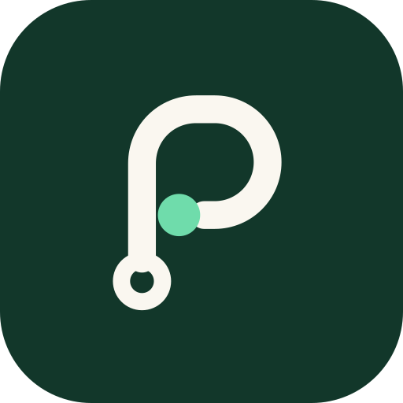

<p align="center">
  
</p>

<h1 align="center">PathAble</h1>

<p align="center"><strong>Accessible pedestrian navigation, starting in Toronto.</strong><br/>
Compare walking and rolling routes by what is actually known about the sidewalk — verified conditions, known barriers, unverified community reports, and missing data — ranked by each person's own mobility preferences.</p>

<p align="center"><em>Every route should be possible.</em> That's the mission, not a promise about any particular sidewalk.</p>

---

> **Status: frontend preview.** The interface, design system, address search and map are real and working. The routing, hazard and photo-analysis services are being built separately; until they're connected, the app runs against **clearly labelled development fixtures** (or an honest "unavailable" state). It is **not** for real-world navigation yet.

## What's in this repository

| Area | What it does |
| --- | --- |
| **Landing page** | Editorial hero with a working destination search and an interactive route illustration (a street grid at Toronto's real 16.5° grid angle) that re-ranks three routes as you switch mobility profile. |
| **Route planner** (`/navigate`) | Map-first planner. Desktop: collapsible sidebar + MapLibre map. Mobile: edge-to-edge map with an accessible bottom sheet (drag *or* buttons/arrow keys). Accessible address autocomplete, "choose on map", "use my location", swap, shareable links. |
| **Route comparison** | Native radio-group of route cards (arrow keys switch routes and the map follows). Each card: distance, time, compatibility with your preferences, a coverage bar of the four knowledge states, barrier/report counts. A plain-language "Why this route?" built from the same numbers used to rank. |
| **Route details & guidance** | Tabs for directions, sections (slope, width, surface, source, date) and hazards, each with "show on map". Large-type step-by-step guidance with optional voice (Web Speech API). |
| **Mobility onboarding** | Four skippable steps. Profiles (manual/powered wheelchair, scooter, walker, cane, reduced mobility, stroller, custom) only *pre-fill* preferences — slope limit, minimum width, stairs, curb ramps, surfaces, reported obstacles, verified/shorter preference. |
| **Barrier reporting** | Photo (EXIF stripped client-side) → location → AI review → details (React Hook Form + Zod) → send. Bounding boxes are drawn **only** from real API output; with no ML service it says so and continues manually. Without a backend, reports are saved locally and labelled "not sent". |
| **Winter** | Snow/ice markers with their own shapes, short expiry, freshness, and a route advisory driven only by on-the-ground reports — never by weather. |
| **Trust pages** | Coverage/status table, accessibility statement, help centre with search, AI transparency, privacy and terms *structures* (marked as drafts), contact. |
| **Settings** | Mobility preferences, theme, contrast, text size (to 150%), motion, voice guidance, language, my reports (withdraw/delete), export & delete all local data. |

## Accessibility, by the numbers

Measured on the production build (details in [`docs/ACCESSIBILITY_AUDIT.md`](docs/ACCESSIBILITY_AUDIT.md)):

- **0 axe-core violations** (WCAG 2.0/2.1/2.2 A & AA + best practices) across **31 scans** — every route in English, key routes in French, dark mode, high contrast, route details, guidance, the command palette and the language menu.
- **Lighthouse Accessibility 100** on every page measured.
- Keyboard-only flows covered by e2e tests: skip link, route radiogroup with arrow keys, combobox autocomplete, command palette, onboarding focus management, bottom-sheet control.
- No horizontal scrolling on any page at 412 px wide, at **150% text size**, or in **right-to-left** layout.
- Every colour pair checked against WCAG contrast in CI (`npm run tokens:check`).
- Every status uses colour **and** line pattern **and** icon/label.

This is evidence for specific checks, **not** a claim of full conformance — no independent audit or testing with disabled participants has happened yet. Manual test scripts for VoiceOver, NVDA and TalkBack are in [`docs/ACCESSIBILITY_TESTING.md`](docs/ACCESSIBILITY_TESTING.md).

## Tech stack

Next.js 16 (App Router, Cache Components, Partial Prefetching, `proxy.ts`) · React 19 · TypeScript (strict) · Tailwind CSS v4 · Radix primitives via shadcn/ui patterns · cmdk · Sonner · Motion · MapLibre GL JS 6 · next-intl 4 (`next/root-params`) · TanStack Query 5 · Zod 4 · React Hook Form · Zustand · Lucide · Vitest · Playwright · axe-core.

Every page is statically prerendered; the planner is a client island with the map code-split.

## Getting started

```bash
nvm use            # Node 22+
npm install        # also copies the MapLibre worker into public/vendor
npm run dev        # http://localhost:3000 → redirects to /en
```

Copy `.env.example` to `.env.local` to configure the backend, map styles and geocoder. With no `NEXT_PUBLIC_PATHABLE_API_URL`, development builds use labelled fixtures; production builds show an "unavailable" state unless `NEXT_PUBLIC_DEV_FIXTURES=true`.

### Quality checks

```bash
npm run check            # contrast tokens + ESLint (incl. jsx-a11y) + typecheck + unit tests
npm run test             # Vitest: 43 unit/component tests
npx playwright install chromium
npm run test:e2e         # Playwright: 61 e2e tests (builds and serves production)
```

## Project structure

```
src/
  app/[locale]/          root layout (locale via next/root-params), (site) and (app) route groups
  api/                   contracts.ts (Zod schemas = API contract), typed fetch, service + fixtures, geocoding
  components/ui/         design-system primitives (adapted shadcn/ui on Radix), feedback, segmented control
  components/magic/      adapted Magic UI components (Blur Fade, Dot Pattern)
  features/
    navigation/          planner, place search combobox, trip store, backend notice
    map/                 MapLibre view, controls, React-portal hazard markers
    routing/             scoring (ranking rules), explanations, route cards, details, guidance, speech
    reporting/           report flow, detection overlay, EXIF stripping, local report store
    preferences/         profiles, preferences/display stores and forms, theme
    hazards/ winter/     hazard visuals & details, winter advisory
    landing/ content/    hero demo, states explorer, trust/help pages
    a11y/ i18n/ commands/ layout/ onboarding/ settings/ brand/
  i18n/                  locale registry (12 languages, 2 enabled), routing, request config
  messages/              en-CA.json, fr-CA.json (+ parity tests)
e2e/                     Playwright specs (axe, navigation, reporting, mobile/RTL/text-scale)
docs/                    architecture, API contract, ranking, design system, a11y, performance, i18n, components
```

## Documentation

- [Architecture & decisions](docs/ARCHITECTURE.md)
- [API contract](docs/API_CONTRACT.md) — what the backend needs to implement
- [Route ranking & explanations](docs/ROUTE_RANKING.md)
- [Design system & brand](docs/DESIGN_SYSTEM.md)
- [Component research & licensing](docs/COMPONENT_RESEARCH.md) · [Third-party notices](THIRD_PARTY_NOTICES.md)
- [Accessibility audit results](docs/ACCESSIBILITY_AUDIT.md) · [Manual accessibility testing](docs/ACCESSIBILITY_TESTING.md)
- [Performance](docs/PERFORMANCE.md)
- [Internationalization](docs/I18N.md)

## Deployment

- **Vercel:** import the repo; set the env vars from `.env.example`. No extra config needed.
- **Docker:** `docker build -t pathable . && docker run -p 3000:3000 pathable`.
- **CI:** `.github/workflows/ci.yml` runs the contrast check, lint, typecheck, unit tests and the full Playwright + axe suite.

## Honesty rules this codebase enforces

- No fabricated statistics, testimonials, partners, certifications, or routes presented as real.
- Development fixtures are labelled at the response level (`source: "development-fixture"`), on every route card, in directions, and in a banner that can be collapsed but not dismissed.
- Unknown sidewalk data is never treated as accessible; "100% safe" never appears except to say we don't claim it (a unit test checks the copy).
- AI suggestions are only drawn from real model output and require human review.
- A response that doesn't match the API contract is rejected, not rendered.

## Credits

Map data © [OpenStreetMap](https://www.openstreetmap.org/copyright) contributors · tiles by [OpenFreeMap](https://openfreemap.org) · search by [Photon](https://photon.komoot.io) · typefaces by the Braille Institute (Atkinson Hyperlegible) and Instrument. See [THIRD_PARTY_NOTICES.md](THIRD_PARTY_NOTICES.md).
