# PathAble

**Every route should be possible.** PathAble is an accessibility-first walking
planner for North York, Toronto. It compares routes by what is actually known
about each sidewalk, and says plainly where nothing is known.

| Planner (1440, light) | Planner (390, dark) |
| --- | --- |
| 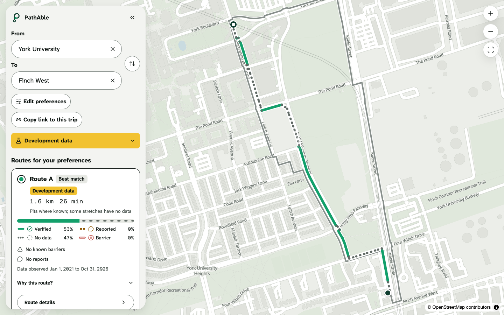 | 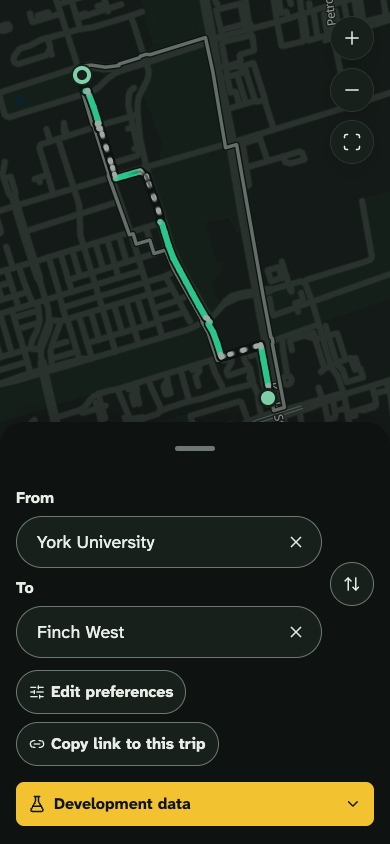 |

| Route details | Landing |
| --- | --- |
| 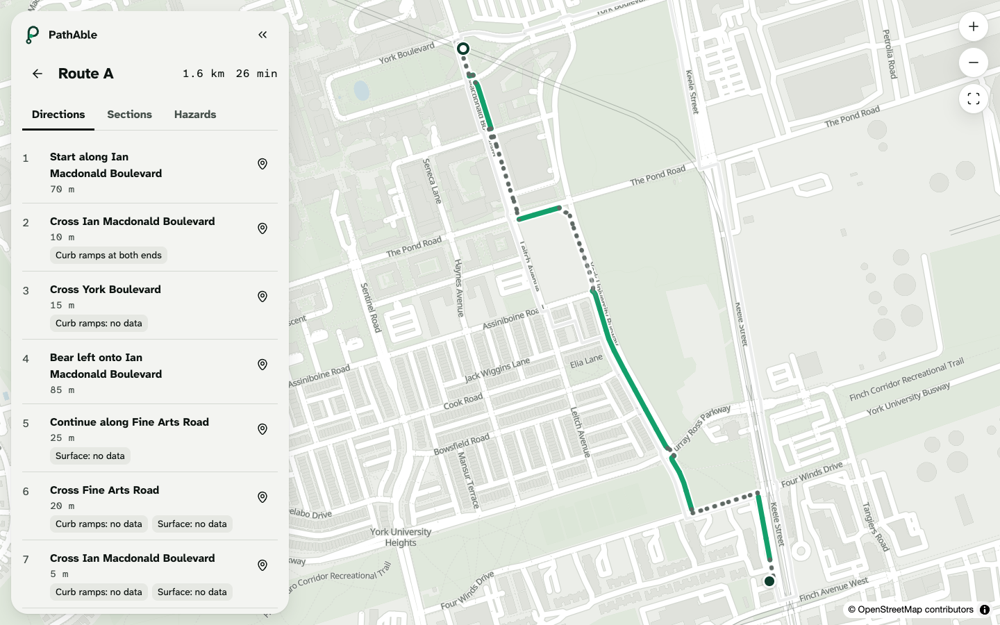 | 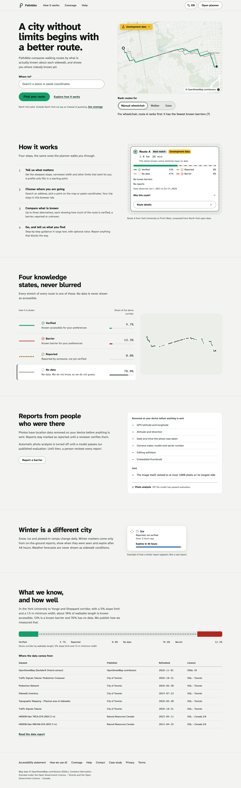 |

## Signature moments

Recorded from the production build with real data and real tiles
(`apps/web/scripts/record-walkthrough.mjs`). Full clips:
[desktop, 51 s](docs/media/walkthrough-desktop.mp4) and
[mobile, 11 s](docs/media/walkthrough-mobile.mp4).

| | |
| --- | --- |
| **Hero map re-ranks by mobility aid**<br>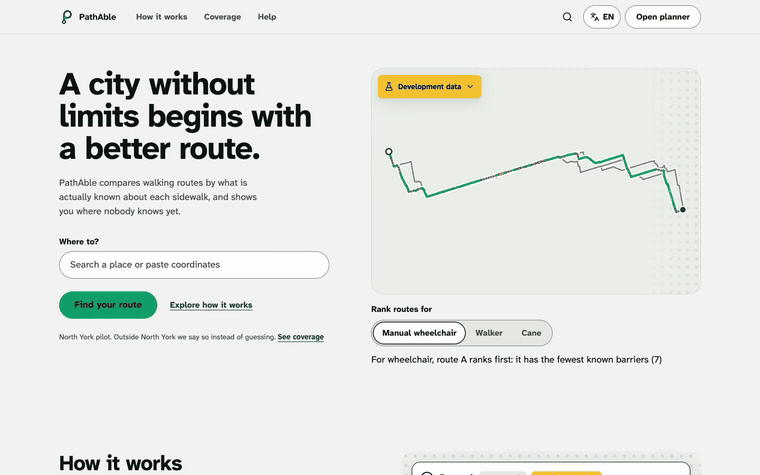 | **Route comparison as a radio group**<br>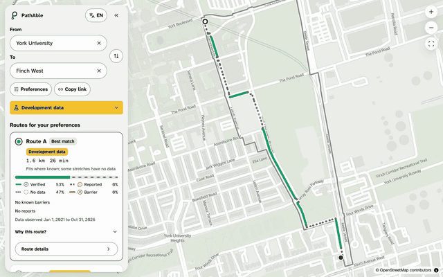 |
| **Details, sections and guidance**<br>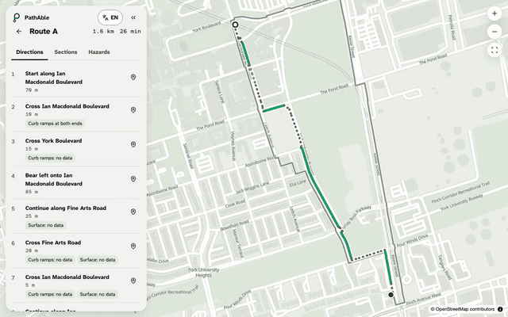 | **Mobile sheet: keys or drag, the route stays framed**<br>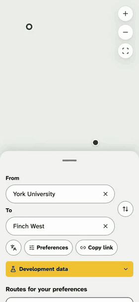 |
| **Four knowledge states on the real corridor**<br>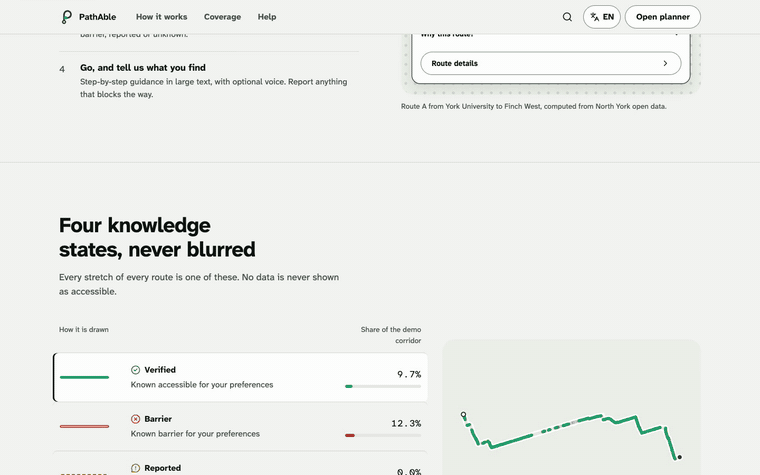 | **Command palette, ⌘K**<br>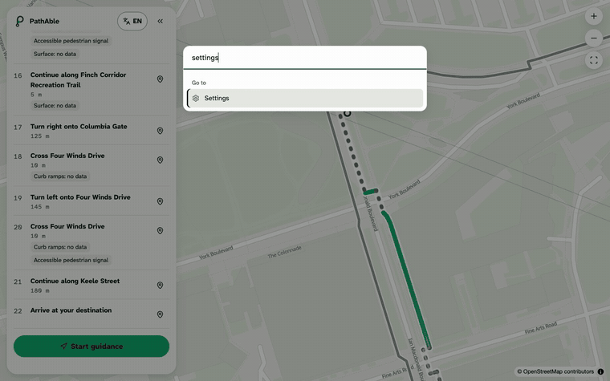 |

## Four knowledge states, never blurred

Every stretch of every route is one of these:

| State | Line on the map | What it means |
| --- | --- | --- |
| **Verified** | solid | Known to meet *your* preferences |
| **Barrier** | solid, with a light centre stripe | Known not to meet them |
| **Reported** | dashed | Someone reported it; not yet verified |
| **No data** | dotted | Nobody knows, so we don't guess |

Each fact shows its source and its observation date. "No data" is never scored
as accessible.

## Guidance and transit

- **Start** turns the planner into live guidance: one large instruction at the
  top, time and distance left at the bottom, and a tilted map that follows you.
  It advances on its own as your location moves along the route, says each
  instruction aloud if you turn voice on, and plans again from where you are
  if you leave the route on foot.
- Away from the route (or with location off), the same screen runs as a
  **preview** that walks the route for you, with pause and step buttons. It
  says it is a preview.
- **Transit**: beside walking routes, the planner offers walk, ride, walk
  options on the TTC schedule (bus, streetcar, LRT and subway), drawn in each
  line's colour. When one saves real time, a single line under the mode switch
  says so. Stops and trips the TTC marks as not accessible are never offered,
  and "step-free" is shown only when the schedule says so for the trip and both
  stops. Times are scheduled, not real-time, and the screen says that too.
  Transfers are not planned yet ([ADR 0004](docs/decisions/0004-transit-options.md)).

## What the data actually supports

Measured in [docs/DATA_REPORT.md](docs/DATA_REPORT.md):

**Across North York:**
- OpenStreetMap represents 88.8% of the City's sidewalk inventory by length.
- 48% of sidewalk length has a surface tag.
- 7.3% of crossings have curb ramps mapped at both ends.
- 49.5% of 574 signals have accessible pedestrian signals.

**Slope** comes from two lidar surveys (2023 and 2015). They agree on which side
of 5% a corridor edge falls for 95% of edges, and slope counts only where they
agree.

**In the demo corridor,** with a 5% slope limit and a 1.5 m minimum width, the
shares of walkable length are:

| Known accessible | Known barrier | No data |
| ---: | ---: | ---: |
| 9.7% | 12.3% | 78.0% |

## Measured results (2026-11-03)

| Check | Result |
| --- | --- |
| axe-core (WCAG 2.2 AA tags) | **0 violations**: 13 pages × 2 languages × 4 themes, plus open menus, dialogs, details and guidance |
| End-to-end (Playwright, production build) | **150 passing**: guidance and transit flows, keyboard flows, 390 px at 150% text, 44 px targets, language switch keeps the trip, honest unavailable states |
| Web unit tests (Vitest) | 64, including shared ranking cases, contract checks of every fixture, and position matching along a journey |
| API integration tests (pytest, PostGIS via testcontainers) | 32, zero warnings, transit on a real slice of the TTC schedule; every response validated against the generated OpenAPI |
| Live end-to-end (production web image, API, PostGIS, object storage) | **14 passing**: live routes, live TTC transit with guidance, search, report with photo, map pick, withdraw, coverage refusal, French |
| Pipeline tests | 27 |
| `/v1/routes` latency, 50 corridor trips, k6 | p95 **121 ms**, p99 **137 ms**, 6 workers ([details](docs/PERFORMANCE.md)) |
| `/v1/hazards` latency | p95 **4.6 ms** |
| `/v1/routes` on the full North York graph | p95 **273 ms**, p99 **345 ms**, 50 borough-wide trips |
| Colour contrast | 156 token pairs pass AA, and AAA text in high-contrast themes |
| Lighthouse, landing | mobile **88** (target 85), desktop **100**; Accessibility 100; CLS 0 ([details](docs/PERFORMANCE.md)) |

## Architecture

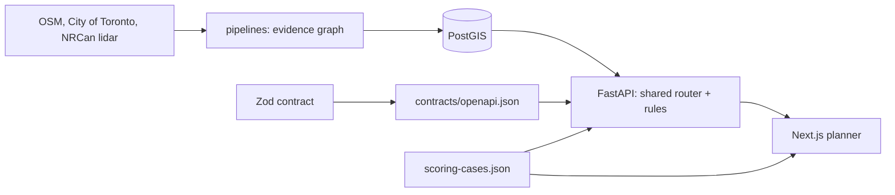

The Zod contract generates the OpenAPI that validates the API. The ranking rules
are written in Python and TypeScript and proven equal by shared cases. The
fixtures come from the same router as the live API. More in
[docs/ARCHITECTURE.md](docs/ARCHITECTURE.md).

## Stack, and why

| Layer | Choice | Why |
| --- | --- | --- |
| Web | Next.js 16, React 19, TypeScript strict, Tailwind v4 | App Router with Cache Components; server-rendered headline as the LCP |
| UI | Radix primitives, Motion, MapLibre, Lucide | Correct semantics without a look we'd have to fight; open vector maps with no API key |
| State | TanStack Query, Zustand | Server data separate from on-device preferences; the trip lives in `sessionStorage` |
| Forms and contract | Zod, React Hook Form | One schema validates requests, responses and forms |
| i18n | next-intl | 12-language registry, en-CA and fr-CA shipped |
| API | Python 3.12, FastAPI, Pydantic v2 | The same language as the geospatial pipeline, so the rules live in one ecosystem |
| Data | PostgreSQL 16 + PostGIS, Alembic (plain SQL), Redis | Spatial queries, an append-only audit trigger, moderation enforced in SQL |
| Pipelines | pyosmium, GeoPandas, Shapely, rasterio | Reads OSM and cloud-optimised lidar directly |

## Run it

```bash
make data       # download sources (~1 GB OSM extract), clip to North York
make up         # PostGIS, Redis, S3, API and web; loads the corridor graph
```

Web on http://localhost:3000, API readiness on http://localhost:8000/readyz.

Without Docker, the web app runs on labelled development fixtures:

```bash
cd apps/web && npm install && npm run dev
```

All checks:

```bash
make check      # contrast, copy, lint, types, unit, API on PostGIS, pipelines
make e2e        # Playwright and axe against the production build
make bench      # k6 against a running API
cd apps/web && npm run test:live   # end-to-end against the running stack from `make up`
```

`make up` from an empty Docker volume takes about 80 s on a laptop, including
loading the corridor graph. For all of North York, run `make load AREA=north-york`
afterwards (about 10 minutes).

## Honest limitations

- **No live demo yet.** It needs hosting accounts.
- **All of North York is built and loaded:** 105,069 edges, with routes p95
  273 ms across the borough. A free-tier deployment can hold only the corridor
  (about 125 MB per worker against about 596 MB for North York).
- **Engine choice is measured, not assumed.** On 50 corridor trips, the
  in-process evidence router chose the same routes as pgRouting (same rules in
  SQL) with a p95 about 75 times lower. Valhalla's and OpenTripPlanner's
  wheelchair routes had 3.5–3.7 times the known-barrier share (14.5% and 13.6%,
  against 3.9%). Both ran without elevation input
  ([ADR 0002](docs/decisions/0002-routing-engine.md)).
- **Width estimates** come from City outlines. They were validated only against
  OSM tags, which are weak evidence. Poles and signs are not subtracted.
- **Slope has not been field-checked.** The 10 sites and the protocol are
  published.
- **Curb ramps are known for about 7% of crossings.**
- **The photo pipeline is not built yet:** upload, server-side EXIF stripping,
  and blurring of faces and plates. Photo analysis is honestly unavailable.
- **No WCAG conformance is claimed.** There has been no manual audit and no user
  testing; [the plan is written](docs/ACCESSIBILITY_TESTING.md).
- **Not built yet:** OpenTelemetry tracing and a CSP.

## Documentation

**Data:**
- [Data report](docs/DATA_REPORT.md)
- [Sources and licences](docs/DATA_SOURCES.md)

**Design:**
- [Design direction](docs/DESIGN_DIRECTION.md)
- [Design log](docs/DESIGN_LOG.md)
- [Component research](docs/COMPONENT_RESEARCH.md)

**Engineering:**
- [Architecture](docs/ARCHITECTURE.md)
- [API contract](docs/API_CONTRACT.md)
- [Route ranking](docs/ROUTE_RANKING.md)
- [Performance](docs/PERFORMANCE.md)
- [Internationalization](docs/I18N.md)
- [ML plan](docs/ML_PLAN.md)
- [Decision records](docs/decisions/)

**Accessibility and project:**
- [Accessibility testing](docs/ACCESSIBILITY_TESTING.md)
- [Case study](docs/CASE_STUDY.md)
- [Third-party notices](THIRD_PARTY_NOTICES.md)

Map data © OpenStreetMap contributors (ODbL). Contains information licensed
under the Open Government Licence – Toronto and the Open Government Licence –
Canada.
