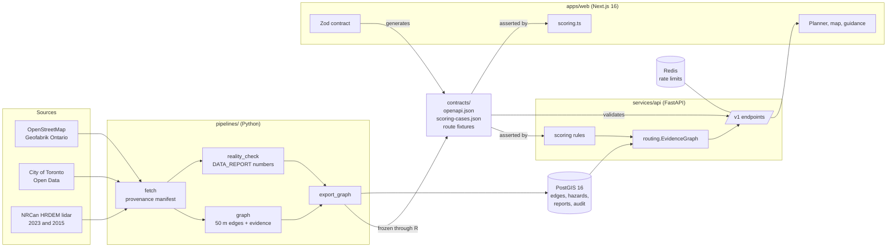

# Architecture

## The contract is the spine

- `apps/web/src/lib/api/contracts.ts` (Zod) defines every request and response.
  `npm run contracts` generates `contracts/openapi.json` from it.
- **The web app** parses every response with the Zod schemas. A response that
  doesn't match is rejected and shown as "we could not verify this response". It
  is never rendered.
- **The API tests** validate every response, including errors, against
  `openapi.json`.
- **CI** fails if the generated files are stale.
- **Human text never crosses the boundary.** Maneuvers, reasons, notes and
  errors are codes, rendered in each language by the client.

## One set of rules, implemented twice, proven equal

Knowledge state and ranking are needed in two places:
- **On the server**, to rank routes.
- **In the browser**, to re-rank instantly when preferences change, and to
  explain "why this route?" from the same numbers.

`pathable_api/scoring.py` and `apps/web/src/lib/scoring.ts` implement the same
rules. Both suites assert `contracts/fixtures/scoring-cases.json`, and the web
suite also re-ranks every route fixture and compares the result segment by
segment.

## One router, used live and frozen

`pathable_api.routing.EvidenceGraph` is the only router.
- The API builds it from PostGIS.
- The pipeline builds the development fixtures through it.
- `test_live_routes_agree_with_the_fixture` proves the two agree.

## Data flow for one request

1. The planner validates the request locally, then calls `POST /v1/routes` with
   the start, destination and preference values. The profile and notes are
   never sent.
2. The API checks the rate limit (Redis). It then checks coverage: the North
   York bounding box, then `ST_Covers` on the loaded data version.
3. The router snaps both ends within 150 m, finds the best route by state cost,
   then alternatives (at most 80% overlap).
4. Shared rules then assign each segment a state, rank the routes and generate
   the reasons. Steps carry maneuver codes and notes.
5. The client parses the response with Zod. It renders segments in colour plus
   pattern, and keeps the previous routes on screen while new preferences load.

## State on the client

| Data | Lives in | Why |
| --- | --- | --- |
| Server data | TanStack Query | Retries only retryable errors; keeps previous data while preferences change |
| Preferences, notes | `localStorage` (Zustand persist) | Personal, survives visits, never sent |
| Current trip and selection | `sessionStorage` | Destinations are sensitive; cleared with the tab |
| Reports and drafts | `localStorage` | So "My reports" can be honest about drafts |
| Theme, contrast, text size, motion | `localStorage` plus an inline boot script | Applied before first paint, so nothing flashes |

Stores live outside the route tree and rehydrate after mount. The planner
waits for the store to rehydrate before seeding a trip from the URL. Without
that, a language switch lost the selected route; an e2e test caught it.

## Security headers

`next.config.ts` sets:
- `X-Content-Type-Options`
- `Referrer-Policy`
- `X-Frame-Options: DENY`
- `COOP`
- HSTS
- a restrictive `Permissions-Policy`

**Content-Security-Policy: TODO.** The production API and tile hosts are not
final, and a wrong CSP silently breaks the map. It will be added with the
deployment.

## Known gaps

- North York is fully built (105,069 edges). Each API worker holds the graph in
  memory, about 596 MB, which is more than free tiers allow.
- Photos are uploaded, re-encoded without metadata and stored privately, but
  faces and plates are not blurred, so no photo is ever served (ADR 0003).
- A free host holds only the corridor. `GET /v1/coverage` says which area is
  loaded, and the coverage page and planner name it.

## Tracing

One trace runs from the browser to the router. The web app sends a W3C
`traceparent` with every API call (two random ids, no tracing library in the
bundle) and uses the trace id as the request id. The API continues the trace
with FastAPI and psycopg instrumentation and its own `router.route` and
`router.transit` spans, and exports over OTLP only when
`OTEL_EXPORTER_OTLP_ENDPOINT` is set. `make trace` starts Jaeger on
http://localhost:16686. Responses still carry `x-request-id` and
`server-timing`.
