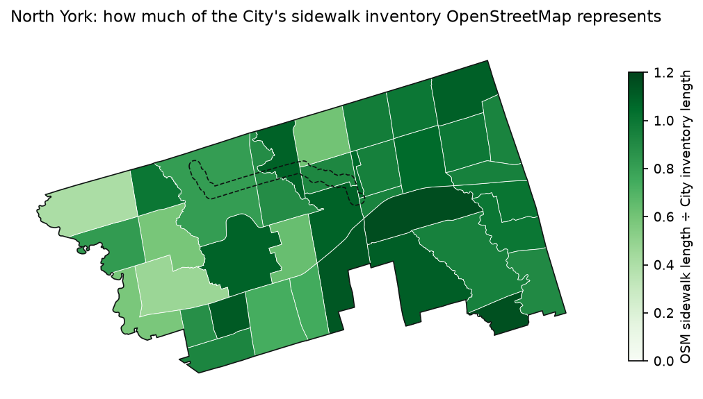
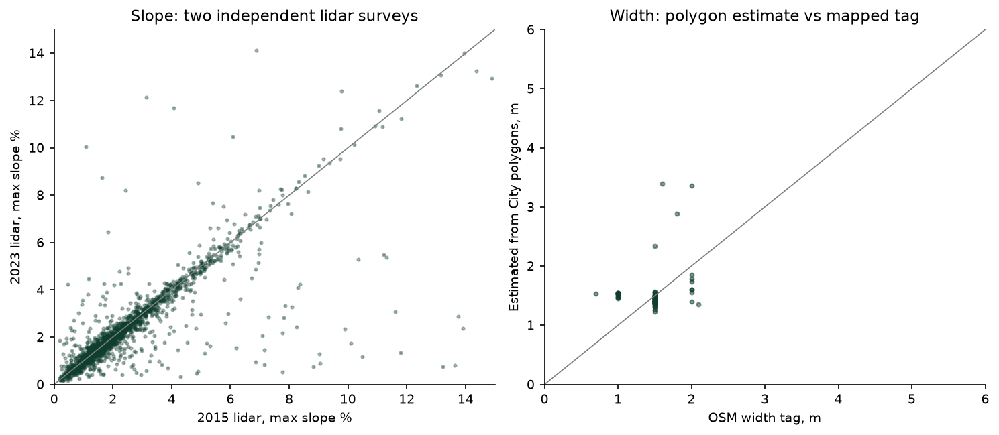
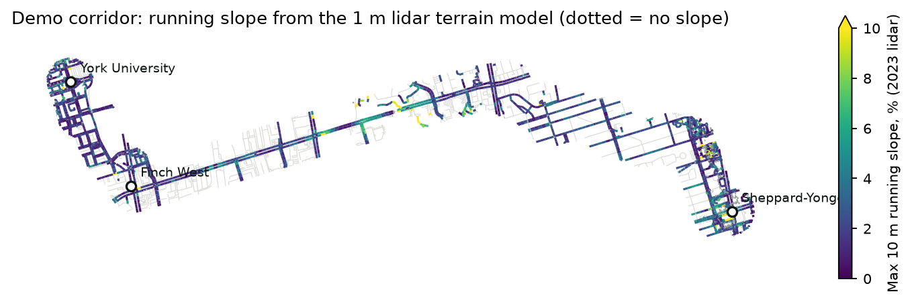
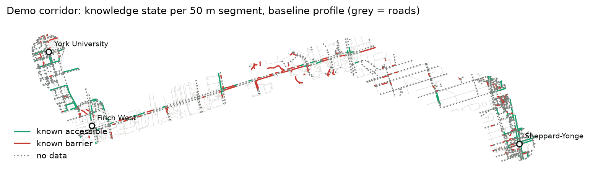

# Data reality check: North York pilot

Milestone 0 gate. This report answers one question before any backend code is
written: **what do open datasets actually know about walking in North York, and
how much of the demo corridor can PathAble describe honestly?**

Every number below comes from `docs/data/reality_check.json`. That file is
written by `pipelines/pathable_pipelines/reality_check.py`. To reproduce:

```bash
cd pipelines
uv sync
uv run python -m pathable_pipelines.fetch          # City of Toronto datasets + manifest
osmium extract -p ../data/raw/osm/north_york.geojson -s smart \
  -o ../data/raw/osm/north_york.osm.pbf ../data/raw/osm/ontario-latest.osm.pbf
uv run python -m pathable_pipelines.reality_check  # numbers + maps (~1 min)
```

Run date: 2026-11-03. OSM extract replication timestamp: 2026-11-01T21:21:36Z
(Geofabrik Ontario, md5 `c8b76c67b4079e7e6b4676418574bd1c`).

## Summary

| Attribute | Best source | North York coverage | Decision |
| --- | --- | --- | --- |
| Sidewalk presence | City Sidewalk Inventory (2015 imagery) + OSM | City: 1,735.9 km of sidewalk sides; OSM represents 88.8% of that length | **Go** |
| Sidewalk geometry for routing | OSM separate sidewalks | 1,386.9 km of `footway=sidewalk` | **Go** |
| Surface | OSM `surface` | 48.1% of sidewalk length | **Go, partial**: the rest is shown as no data |
| Width | City topographic sidewalk polygons (gross width estimate) | 93.9% of OSM sidewalk length gets an estimate | **Provisional go**: labelled as an estimate; not clear width |
| Running slope | TRCA GTA 2023 lidar DTM, 1 m, cross-checked against the NRCan 2015 survey | 92.6% of corridor length; 86.5% where both surveys agree | **Go**, pending the 10-site field check |
| Cross slope | none | 0% | **No go**: a 1 m DTM cannot resolve cross slope across a 1.5 m sidewalk |
| Curb ramps | OSM `kerb` | both ends known on 7.3% of crossings | **No go**: community reports now, model later |
| Tactile paving | OSM `tactile_paving` | 12.6% of crossing nodes | **No go** for routing; shown where present |
| Accessible pedestrian signals | City Traffic Signals Tabular, `AUDIBLEPEDSIGNAL` | 49.5% of 574 North York signals are recorded with APS; the rest are blank or `-1` and are shown as no data | **Go** |
| Signals and crossovers | City Traffic Signals Tabular | 574 signals, 54 pedestrian crossovers | **Go** |
| `incline`, `wheelchair` tags | OSM | 0.5% and 0.0% of pedestrian length | **No go** |
| StatCan Canadian Pedestrian Network Database | StatCan | Toronto rows are a 2020 copy of the City Pedestrian Network; width empty, material `..` on all 75,891 rows | **No go**: adds nothing over the City source |

**Expected corridor knowledge states**, by length, for the baseline profile
(running slope ≤ 5%, width ≥ 1.5 m, paved, no steps, kerbs lowered or flush at crossings):

| State | Share of corridor length |
| --- | --- |
| Known accessible | 9.7% |
| Known barrier | 12.3% |
| Reported but unverified | 0.0% (no community reports exist yet) |
| No data | 78.0% |

The gate passes. The data supports an honest product. It does not support a
product that claims most routes are accessible. About four-fifths of the
corridor will be drawn as **no data**, mostly because surface is untagged and
curb ramps are unknown. That gap is the product's reason to collect reports.

## 1. Pilot boundary

- **Dataset:** City of Toronto Open Data, *Former Municipality Boundaries*
  (`former-municipality-boundaries`), feature `AREA_NAME = "NORTH YORK"`.
- **Licence:** Open Government Licence – Toronto.
- **Last refreshed:** 2026-02-20.
- **Measured area:** 176.6 km² in EPSG:2952.
- **Neighbourhoods:** 37 of the City's 158 neighbourhoods have a representative
  point inside North York (*Neighbourhoods*, refreshed 2026-02-20). They are
  used for per-area reporting.

## 2. OpenStreetMap

North York, clipped from the Geofabrik Ontario extract. The figures cover
pedestrian ways (`highway` = footway, path, pedestrian, steps or living_street)
that are not `foot`/`access` = no or private. Percentages are shares of length.

| | Ways | km | surface | smoothness | width | incline | wheelchair | tactile_paving |
| --- | ---: | ---: | ---: | ---: | ---: | ---: | ---: | ---: |
| All pedestrian ways | 23,439 | 1,988.8 | 46.7% | 0.5% | 1.1% | 0.5% | 0.0% | 0.2% |
| Sidewalks (`footway=sidewalk`) | 8,510 | 1,386.9 | 48.1% | 0.4% | 1.1% | 0.1% | 0.0% | 0.0% |
| Crossings (`footway=crossing`) | 6,200 | 99.0 | 44.4% | 0.4% | 0.1% | 0.1% | 0.0% | 2.4% |

**Demo corridor** (250 m either side of the walking path; see section 6):

| | Ways | km | surface | smoothness | width | incline | tactile_paving |
| --- | ---: | ---: | ---: | ---: | ---: | ---: | ---: |
| All pedestrian ways | 1,292 | 77.9 | 52.3% | 1.0% | 0.0% | 0.3% | 0.1% |
| Sidewalks | 420 | 50.0 | 54.1% | 1.5% | 0.0% | 0.0% | 0.0% |
| Crossings | 261 | 4.7 | 56.7% | 1.9% | 0.0% | 0.0% | 1.3% |

**Crossings and kerbs.**
- Of 6,200 crossing ways, 7.3% have kerb information at both ends (10.7% in the
  corridor). Kerb information means kerb-tagged nodes on the way, or a `kerb`
  tag on the way itself.
- North York has 1,233 kerb nodes: 1,043 lowered, 99 flush, 66 raised, 15 no,
  7 yes and 3 rolled.
- Only 0.3% of the 9,527 `highway=crossing` nodes carry a `kerb` tag.
- 12.6% of those crossing nodes carry `tactile_paving`.

**Presence compared with the City.**
- The City inventory records 1,735.9 km of sidewalk sides in North York: a
  segment with sidewalks on both sides counts twice.
- OSM represents 1,541.2 km (88.8%). That total is separate sidewalk geometry
  plus `sidewalk=*` tags on roads.
- Across the 37 neighbourhoods the median is 95.1%. Two neighbourhoods are
  below 50%; the lowest is Humber Summit at 41%.
- Ratios above 100% (St. Andrew-Windfields, 116%) are expected. OSM maps
  campus and park paths beside roads, which the inventory does not count.



**Licence:** ODbL 1.0. Attribution "© OpenStreetMap contributors" is required.
A conflated database derived from OSM is a derivative database, so share-alike
applies to it; see [ADR 0001](decisions/0001-pilot-data-sources.md).

## 3. City of Toronto Open Data

All datasets below use the Open Government Licence – Toronto. Names, refresh
dates and checksums are those recorded in `data/raw/manifest.json` at fetch time.

| Dataset (package id) | Last refreshed | What it holds | Finding |
| --- | --- | --- | --- |
| Sidewalk Inventory (`sidewalk-inventory`) | 2019-07-23 | Presence per centreline segment and side, `Partial`, `Multiuse` | The README confirms presence was traced from **spring 2015** aerial imagery. It holds no width, surface or condition. In North York, 8.1% of segments with a sidewalk are partial, and 388.2 km of road has no sidewalk on either side. |
| Pedestrian Network (`pedestrian-network`) | 2026-02-20 | 87,105 lines city-wide: the sidewalk inventory joined to centreline intersections, crosswalks (`CROSSWALK_TYPE`: ts / ns / pc) and signals | A routable fallback network. It is not newer evidence about the sidewalk itself. |
| Topographic Mapping – Physical area of sidewalks (`topographic-mapping-physical-area-of-sidewalks`) | 2026-02-20 | Sidewalk polygons; geometry maintained 2021-01-01 to 2024-11-26 | 3,411 polygon parts covering 2.8 km² in North York. This is the width source (section 4). The `ELEVATION` field is 0 on 14,096 of 14,116 features, so it is unusable. |
| Traffic Signals Tabular (`traffic-signals-tabular`), *Traffic Signal* resource | 2026-10-31 | 2,563 signals city-wide with `APS_OPERATION`, `AUDIBLEPEDSIGNAL`, `PEDWALKSPEED`, leading pedestrian interval dates | North York has 574 signals. 49.5% have an audible pedestrian signal; 283 are push-button actuated and 291 are recorded as "None". |
| Traffic Signals Tabular, *Pedestrian Crossover* resource | 2026-10-31 | Pedestrian crossovers (PXOs) | 54 in North York. |

**Accessible pedestrian signals.**
- The catalogue does not list a stand-alone "Accessible Pedestrian Signals"
  dataset. I searched for `accessible`, `pedestrian signal` and
  `traffic signal` on 2026-11-03.
- The APS facts live in the Traffic Signals Tabular fields above, and PathAble
  uses those.

**Other datasets.**
- No curb ramp, slope, cross slope or sidewalk condition dataset was found. I
  searched for `curb`, `ramp`, `sidewalk` and `topographic`.
- *Sidewalk Construction Program* (refreshed 2026-11-02) and *Road
  Reconstruction Program* list planned work. They are candidates for "this may
  have changed" warnings in Milestone 3, not for accessibility facts.
- *Topographic Mapping – Poles* (refreshed 2026-02-20) could subtract pole
  footprints from gross width later. It is not used yet.

## 4. Width from sidewalk polygons

**Method.**
1. Along every OSM sidewalk, cast a 12 m perpendicular transect every 10 m.
2. Intersect it with the City polygons and keep the piece within 1 m of the
   sample point.
3. A way gets a width only if at least half its transects hit a polygon. The
   way's width is the median of its transects.
4. Code: `measure.transects`, `measure.width_at`; unit-tested against a known
   rectangle.

**Coverage.**
- 93.9% of North York sidewalk length gets an estimate.
- The median sidewalk is 1.50 m wide.
- 60.8% of estimated length is narrower than 1.5 m. None is narrower than 0.9 m.

**Validation.** This is weak, and I am saying so plainly.
- 78 OSM sidewalks have a numeric `width` tag and a polygon estimate.
- Median absolute difference: 0.12 m. Mean: 0.26 m. Bias: +0.07 m.
- Most of those tags are exactly `1.5`, which looks like a default rather than
  a measurement (right panel below). That makes the comparison close to
  circular.
- Real validation needs tape-measure readings at surveyed sites. Until then the
  product labels width as *"estimated from City mapping, 2021–2024"* and treats
  it as gross width. Poles, hydrants and signs are not subtracted, so the true
  clear width can only be narrower.

**Consequence for knowledge states.**
- A width counts as known only when it is more than the measured error
  (0.12 m) away from the person's threshold. Values closer than that are no
  data.
- Polygon width is an upper bound on clear width, so a narrow polygon is solid
  evidence of a barrier. A wide polygon is weaker evidence of passability, and
  the route explanation says so.



## 5. Slope

**Terrain models.** Both are from NRCan's *High Resolution Digital Elevation
Model (HRDEM), by lidar acquisition project* (STAC collection `hrdem-lidar`).
Both are licensed under the Open Government Licence – Canada 2.0, are 1 m
bare-earth DTMs in EPSG:3979, and are read as cloud-optimised GeoTIFFs:

- `TRCA-GTA_2023-1m`: Toronto and Region Conservation Authority, acquired
  2023-05-11. This is the **primary** model.
- `NRCAN-GTA2015-1m`: acquired 2015-04-25. Used as an **independent check**.

**Method.**
1. Split corridor ways into graph edges of at most 50 m.
2. Sample each terrain model every 2 m along the edge with bilinear
   interpolation.
3. Median-filter the profile over five samples. This removes curb-face spikes
   and is unit-tested.
4. Take the steepest 10 m window as the edge's running slope.
5. Exclude steps, bridges, tunnels, indoor ways and ways with a non-zero
   `level`. A bare-earth model says nothing about them, so they get no slope
   rather than a wrong one.

**Results** (2,412 corridor edges).
- 92.6% of corridor length has a 2023 slope.
- **Two independent surveys agree.**
  - Median absolute difference between the 2023 and 2015 slopes: 0.17
    percentage points.
  - 90th percentile: 1.06 pp.
  - They put an edge on the same side of 5% for 95.0% of edges.
- The outliers in the left panel are real ground changes, not noise. One
  example: the 2015 survey shows a 175% "slope" at York University station,
  which was under construction then and opened in 2017.
- **Rule adopted:** a lidar slope counts as known only when both surveys land on
  the same side of the person's threshold, and are more than 0.17 pp from it.
  That covers 86.5% of corridor length.
- 10.0% of corridor length has a 10 m window steeper than 5%.

**Known failure mode.**
- The steepest edges are plazas and walkways around Mel Lastman Square and the
  North York Centre station entrances. They read 25–44% in both surveys, which
  points to unmapped stairs or retaining walls beside the mapped way.
- They are correctly *not passable*. The product must still not describe them
  as "a 44% slope". The explanation says "a steep change in ground level was
  measured here", with the source and date.

**Field validation has not happened.** The spec asks for 10 surveyed or Street
View–checked locations, and I cannot visit sites or view Street View.
- The pipeline selects 10 corridor edges for a person to check. They are
  stratified across the slope bands 0–2, 2–4, 4–6, 6–8 and > 8%, so error is
  measured everywhere, not only at extremes.
- They are listed below with their status. The error column fills in when
  someone checks them with a digital level or smartphone inclinometer, using
  the protocol in `docs/ACCESSIBILITY_TESTING.md`.

| # | OSM way | Lat, lon | 2023 lidar | 2015 lidar | Field reading | Status |
| ---: | --- | --- | ---: | ---: | --- | --- |
| 1 | 845201610 | 43.770435, -79.501045 | 2.0% | 2.3% | | not yet checked |
| 2 | 1524115090 | 43.770718, -79.436004 | 2.0% | 1.7% | | not yet checked |
| 3 | 845201610 | 43.770840, -79.501136 | 2.3% | 2.3% | | not yet checked |
| 4 | 132057995 | 43.771921, -79.442709 | 3.8% | 3.9% | | not yet checked |
| 5 | 1550217388 | 43.773475, -79.497657 | 5.8% | 5.6% | | not yet checked |
| 6 | 1037279796 | 43.765514, -79.481315 | 4.5% | 6.7% | | not yet checked |
| 7 | 66979686 | 43.770833, -79.447002 | 6.6% | 7.0% | | not yet checked |
| 8 | 983737686 | 43.769839, -79.451935 | 7.0% | 7.2% | | not yet checked |
| 9 | 613144330 | 43.761070, -79.412213 | 12.9% | 14.9% | | not yet checked |
| 10 | 762558247 | 43.770722, -79.467137 | 15.3% | 14.8% | | not yet checked |



**Ontario's Digital Terrain Model (Lidar-Derived).** It is published on Ontario
GeoHub under the Open Government Licence – Ontario. I did not use it because
HRDEM already serves the same TRCA acquisition as range-readable COGs. That
avoids a second download path with no new information.

## 6. Demo corridor

- **Anchors:** OSM station nodes for York University, Finch West and
  Sheppard-Yonge, matched by name rather than typed coordinates.
- **Path:** the shortest walkable path through them on the OSM graph, excluding
  trunk roads and `foot=no`. It is 9.43 km.
- **Corridor:** the path buffered by 250 m.
- **Units of measurement:** 2,412 edges of at most 50 m, which is the length
  cap the routing graph will use.

**Baseline profile.**

| Attribute | Rule |
| --- | --- |
| Running slope | ≤ 5%: the 1:20 limit for exterior paths of travel in O. Reg. 191/11 s. 80.23. The regulation lets a sidewalk be steeper where the adjacent road is, so > 5% is a barrier *for this person*, not a code violation. |
| Width | ≥ 1.5 m (the s. 80.23 minimum clear width of 1,500 mm) |
| Surface | in the paved set in `measure.SURFACE_PASS` |
| Steps | none |
| Crossings | kerbs lowered, flush or `no` at both ends |

**Combining attributes.**
- An edge is a **known barrier** if any known attribute fails.
- It is **known accessible** only if every attribute is known and passes.
- Otherwise it is **no data**.
- Barriers by cause, as a share of corridor length: slope 7.5%, width 3.5%,
  surface 1.4%, steps 0.5%, kerbs 0.0%. One edge can have more than one cause.

**Attribute knowledge on the corridor**, as a share of length:

| Attribute | Known |
| --- | --- |
| Surface | 52.3% |
| Width estimate | 52.9% (sidewalks only; footpaths and crossings have no polygon) |
| Slope, 2023 | 92.6% |
| Slope, both surveys agree | 86.5% |
| Kerbs at both ends of crossings | 12.1% of crossing length |

**The width threshold changes the picture more than anything else.**

| Minimum width | Known accessible | Known barrier | Unverified | No data |
| --- | ---: | ---: | ---: | ---: |
| 0.9 m | 26.0% | 9.1% | 0.0% | 64.9% |
| 1.2 m | 25.4% | 9.2% | 0.0% | 65.4% |
| 1.5 m | 9.7% | 12.3% | 0.0% | 78.0% |

At 1.5 m the threshold sits on the typical North York sidewalk width. Most
edges then fall inside the measurement error and become no data. This is why
minimum width is a personal preference and not a fixed rule. It is also why
`/v1/routes` must return per-attribute evidence, not a single precomputed flag.



## 7. Curb ramps: the expected gap

- Curb ramp presence is the single most important fact for wheelchair routing.
- No City dataset covers it.
- OSM covers both ends of only 7.3% of North York crossings.

**Plan.**
1. **Now:** crossings without kerb data are **no data**, never assumed fine.
   Community reports, with a photo, location and moderation, are the first way
   to add data.
2. **Later:** model-assisted detection from street-level imagery, behind the
   evaluation gate in `docs/ML_PLAN.md`. Prior work:
   - Project Sidewalk (Saha et al., CHI 2019): crowdsourced labelling of curb
     ramps and obstacles in Google Street View.
   - RampNet (O'Meara et al., arXiv:2508.09415). It converts government curb
     ramp locations into labels on Google Street View panoramas (over 210,000
     images), then trains a ConvNeXt V2 detector on them.

   Neither model's training imagery is licensed for reuse here, so training data
   has to be licensed or collected; see the ML plan.

## 8. Risks and follow-ups

- **Sidewalk presence is from 2015 imagery.** It is labelled with that date and
  never as current.
- **OSM `surface` is set by individual mappers** and may be stale. Each value
  carries the way's last-edit timestamp, and the API returns it as the
  observation date.
- **Bare-earth DTM near walls and stairs**, and **construction since 2023**: the
  two-survey rule covers some cases, and the field check measures the rest.
- **ODbL share-alike** applies to the conflated database (ADR 0001).
